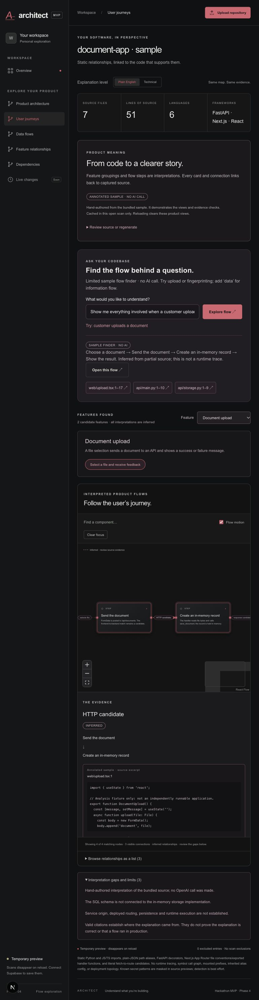
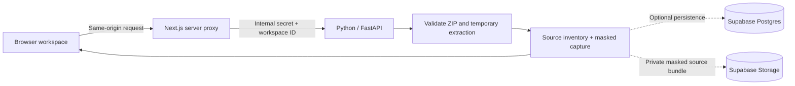

# Architect

### See your codebase clearly.

**Repository:** [Harshakoliki/Architect](https://github.com/Harshakoliki/Architect)

Architect is an evidence-first visual workspace for understanding software. The long-term goal is to turn a repository into six connected perspectives: **architecture, user journeys, data flows, feature relationships, dependencies, and evolution**.

This hackathon repository contains the **Phase 4 MVP checkpoint**: upload a small repository ZIP, explore imports and declared routes, inspect code-linked evidence, build inferred feature, journey, and data-flow views from bounded source excerpts, ask source-grounded flow questions, and switch between Plain English and Technical explanations. The interface follows a charcoal-and-red visual language inspired by architectural diagrams and product flow maps.

> **Current status — 10 October 2026:** architecture/dependency explorer, source inventory, evidence panel, feature/source map, user journeys, and data flows. OpenAI Structured Outputs integration is implemented and tested with the real SDK against mocked provider responses; **a live OpenAI call has not been verified because no API key is configured**. A clearly labeled hand-authored sample demonstrates the product views without a key. A limited sample question finder and Plain English / Technical switch work without a key. OpenAI-backed questions are implemented with citation/navigation checks; live behavior remains unverified. GitHub ingestion and history remain planned. Optional Supabase persistence awaits the owner's separate project. Hosting is intentionally deferred.



## Why this exists

Reading a new codebase takes time. A developer needs implementation details; a founder or product manager needs to understand what the software does and how changes affect it. Architect aims to give them one shared model with different levels of explanation and code-linked evidence.

We start with a simple promise: **show what the source actually supports, label inference, and make missing information visible.** A beautiful diagram is useful only when its connections are trustworthy.

## What works today

| Capability | Current behavior |
|---|---|
| Repository input | ZIP upload, up to 3 MiB compressed / 20 MiB expanded / 3,000 entries |
| Sample | Bundled document-upload source fixture, scanned by the real scanner |
| Safe scanning | No repository execution or dependency installation; rejects unsafe ZIP paths, duplicate entries, encrypted files, and symlinks |
| Inventory | Real file/line counts, languages, and manifest-based framework detection |
| Visualization | Interactive architecture/dependency graph, zoom/pan/focus, restrained red motion on selected connections, and searchable inventory |
| Static analysis | Python AST and tree-sitter JS/TS imports, plain-JSON path aliases, FastAPI route declarations, basic Next.js App Router route/page conventions |
| Honest gaps | Unresolved imports, parser failures, dynamic boundaries, and an explicit candidate label on HTTP method/path matches |
| Product interpretation | Optional OpenAI feature proposals, user journeys, and data flows; every generated feature/step/transition must cite available source excerpts |
| Sample product views | Hand-authored, validated document-upload and fingerprinting example; explicitly labeled as not an OpenAI result |
| Questions | Source-grounded OpenAI answers after consent; limited annotated-sample flow finder without a key; uncertain requests do not open a flow |
| Explanation level | Plain English or Technical card detail; stable graph identity, selection and evidence |
| Evidence | Captured source viewer with line numbers, original file SHA256, and best-effort masking of known secret patterns |
| Persistence | Optional private Supabase source storage and server-only scan metadata; preview mode works without credentials |
| Workspace boundary | Random browser session cookie scopes saved scans; no account signup |
| Presentation | Responsive dark interface, keyboard focus states, reduced motion, explicit empty/error/loading states |

**Architecture edges carry explicit meanings:** `imports`, `references`, `implemented by`, and `HTTP candidate`. Observed relationships, inferred candidates, and unresolved links are labeled. The separate inventory diagram means “contains.” Neither view is a runtime execution trace.

## Quick start

### Requirements

- Node.js **20.9+**, npm, Python **3.12+**, and [uv](https://docs.astral.sh/uv/getting-started/installation/).
- No OpenAI or Supabase key is needed to try the demo in temporary preview mode.
- macOS/Linux launcher. On Windows, run the two services manually with your virtual environment's Python path.

From the repository root:

```bash
cd backend
uv sync --python 3.13
cd ../frontend
npm ci
cd ..
python3 dev.py
```

Open **http://127.0.0.1:3000**. The Python API runs on port 8000. The launcher creates an in-memory internal service secret and passes it to both services. Press Ctrl+C to stop them.

For configuration, copy `.env.example` to `.env` at the repository root. The launcher reads it. Keep real credentials out of Git. Shell environment variables take precedence over `.env`.

### Demo in two minutes

1. Click **Explore sample**. This scans actual files from `backend/fixtures/document-app/`.
2. See seven real source files, three parsed source modules, and six extracted relationships.
3. Select `web/upload.tsx`; choose **Focus this component** to zoom into its neighborhood.
4. Click the red **HTTP candidate** connection to `POST /api/documents`. The evidence inspector shows both the literal frontend fetch and the FastAPI route. The inferred label explains what the match does not prove.
5. Click **Open supporting source** to see the relevant captured line highlighted.
6. Click the `api/main.py` → `api/storage.py` **imports** line: this is an observed Python import, with exact source evidence.
7. Switch to **Dependencies** to hide route candidates and examine module references. Use **Overview** for folder filtering and file search. On smaller screens, use the **Explore** selector.
8. Toggle **Flow motion** off, or use system reduced motion. The map supports zoom, pan, fit, search, a minimap, and a relationship list.
9. Open **User journeys** and choose **Explore annotated sample**. Follow document selection → HTTP candidate → in-memory record → feedback. The provider label explicitly says no AI call was made.
10. Switch to **Data flows** and choose **Document fingerprinting** to see bytes → identifier. Open any card or connection to inspect its supporting source excerpt.
11. Open **Feature relationships** to see candidate features connected to their cited files. Shared source does not establish a feature-to-feature dependency.
12. In a product view, use **Try: customer uploads a document**, click **Explore flow**, review the citations, and click **Open this flow**. Try **Show document** to see a clarification, or **Show document upload data** to open the data-flow view.
13. Switch **Plain English / Technical** above the map. The same nodes and selected evidence remain; descriptions, source-path detail and static connection wording change.
14. Upload another small repository ZIP to inspect real supported source relationships. Configure OpenAI privately to generate product views for that upload.

The fixture's SQL schema is intentionally unconnected to its in-memory storage. The analyzer does not invent a database connection just because a SQL file exists.

### Enable OpenAI product views — optional

1. Copy `.env.example` to `.env` in the repository root.
2. Set `OPENAI_API_KEY` in that ignored file, **never in chat, browser fields, source code, or Git**.
3. Keep `OPENAI_MODEL=gpt-6.1-sol` or select another Responses model with Structured Outputs support available to your API project. The default was checked against official documentation on 2026-10-10; account access has not been verified.
4. Restart `python3 dev.py`, open a scan, and select User journeys, Data flows, or Feature relationships.
5. Expand **Review the source bundle** to inspect precisely which excerpts are selected. Check the consent box, then click **Build product views with OpenAI**.

The API receives at most 12 excerpts / 48 KB of context. Selection prioritizes declared-route/HTTP-candidate source and then supported code files; excerpts are bounded to 100 lines and 6,000 bytes. This is partial coverage, not a complete repository reading. Known secret patterns are masked again before transmission. Source, comments, and filenames are treated as untrusted data; no model tools or repository execution are available.

One foreground Responses call uses `store=false`, a 45-second SDK timeout, no automatic retries, and a 6,000-output-token cap. One call may be in flight per Python process. The app records returned model/token usage and verifies citation membership plus flow endpoint/step identity before attaching a result. These checks do **not** establish that AI prose is factually correct. All product interpretations remain inferred. [OpenAI Structured Outputs](https://developers.openai.com/api/docs/guides/structured-outputs), [OpenAI data controls](https://developers.openai.com/api/docs/guides/your-data).

Results are cached in the currently open browser scan only. Layer switching reuses them; reload/reopening requires regeneration. They are not persisted to Supabase in this phase. `store=false` does not guarantee zero provider retention. A user-initiated regeneration may incur another API charge. Missing keys, refusal, invalid citations, incomplete output, and provider failures preserve the static map.

### Ask a flow question

Open User journeys, Data flows or Feature relationships after building product views. Questions select an existing feature/flow and return supporting excerpt links; **Open this flow** navigates to that view. They do not generate new steps or execute the application. Unsupported or ambiguous responses carry no navigation target.

The bundled annotated sample uses a **limited lexical flow finder, not AI**. It recognizes document upload/fingerprinting and data-flow intent; it cannot diagnose failures, security, latency or runtime behavior. Arbitrary repository questions use OpenAI after separate consent to transmit the question, existing interpretation and reviewed source bundle. Requests are bounded to 128 KB, questions to 500 characters, and use the same timeout, store=false, single-call lock and output limits as interpretation. Returned citations and feature/flow indexes are checked before navigation. Valid references do not prove the answer is true. The existing interpretation itself is inferred, and the supplied browser snapshot is not server-attested.

Plain English uses explanatory card descriptions and friendlier static connection labels. Technical uses cited paths/line numbers and available code previews. Both retain uncertainty labels, source access, graph IDs and current selection. This is a presentation switch, not a claim of different analysis quality.

### Create a small upload example

For an existing repository, remove secrets, dependencies, generated outputs, large binaries, and unnecessary files **before** creating a ZIP. Architect skips common credential files during analysis, but the complete archive reaches the server before those exclusions are applied.

The downloadable GitHub source ZIP of a small public repository also works. A sole outer ZIP directory is normalized away. Large repositories are outside this MVP limit.

## Architecture



- **Next.js + TypeScript** render the application and proxy a fixed set of API routes. No service or Supabase secret is exposed to the browser.
- **FastAPI + Python** validate uploads, read source, detect languages/frameworks, parse supported imports/routes, mask common secrets, and return real evidence graphs.
- **Supabase Postgres** stores scan metadata, the evidence graph, and file inventory. **Supabase Storage** stores a gzip-compressed JSON bundle of captured, masked source. The original ZIP is not persisted.
- Scanning happens within the active request. There is no daemon, detached job, or persistent server disk dependency.
- Without Supabase configuration, results remain in the page's memory. Reloading loses the preview. Temporary extraction directories are removed after scanning.
- Stopping the browser wait does not guarantee server work or an already-started save is canceled.

### Repository layout

```text
frontend/app/                  Browser interface and server proxy
backend/architect/             ZIP boundary, scanner, analyzer, OpenAI product views, API, Supabase adapter
backend/fixtures/document-app/ Source-only sample; never auto-executed
backend/tests/                 Security, scanner, API, and persistence-boundary tests
supabase/migrations/           Backend-only database/storage setup
outputs/                       TRD, phased plan, design decisions, verification report
visual-product-intelligence-prd.md  Original product vision and competitor research
.env.example                   Configuration names; no real secrets
dev.py                         Local two-service launcher
```

## Supabase setup — optional

Use a **separate project**, as selected by the owner. No unrelated Supabase project should be reused.

1. Create/provide that project in your Supabase dashboard.
2. Apply both files in `supabase/migrations/` in timestamp order using Supabase migrations or the dashboard SQL editor.
3. Set these **backend-only** variables:

```dotenv
SUPABASE_URL=https://YOUR_PROJECT.supabase.co
SUPABASE_SECRET_KEY=YOUR_SERVER_SECRET_KEY
```

New `sb_secret_...` keys are sent in the `apikey` header. Legacy service-role JWT keys are also supported. **Do not use an anonymous/publishable key here. Never prefix a secret with `NEXT_PUBLIC_`.**

The migration enables RLS, removes browser-role table grants, and creates a private storage bucket with no browser access policy. The server key bypasses RLS, so the backend also filters **every read by the workspace identifier**.

The workspace identifier is a random, HTTP-only, SameSite cookie lasting 30 days. It is an anonymous bearer capability, not an account. Clearing cookies or changing browser loses access to that workspace's saved scans. Account recovery, collaboration, and mature abuse controls are deferred.

## Vercel deployment plan — deferred by owner

This repository is prepared for **two Vercel projects** from the same Git repository:

### 1. Python analysis service

- Root directory: `backend`
- Framework: FastAPI; application export: `main.py` → `app`
- Set `ARCHITECT_SERVICE_SECRET` to a new random value of at least 32 characters.
- Optionally set the two Supabase variables above.
- `backend/vercel.json` requests a 60-second function duration. Check the selected plan's limits.

### 2. Browser app

- Root directory: `frontend`
- Framework: Next.js
- Set `ARCHITECT_SERVICE_SECRET` to the same value as the backend.
- Set `ARCHITECT_BACKEND_URL` to the Python service's HTTPS origin, without a trailing slash.
- Do not set Supabase secrets on the frontend project.

Use HTTPS. Keep the hackathon deployment private/protected when inspecting private code. If backend Vercel Deployment Protection is enabled, requests from the frontend need a supported protection bypass configuration; this proxy does not implement that yet. Do not mistake an untested deployment configuration for a verified live demo.

The 3 MiB ZIP limit leaves room beneath Vercel's documented 4.5 MB request-body limit. Large scans need a direct private upload and a durable worker, which are deferred. The current API is not ready for unrestricted public uploads: there is no user account, durable quota, or complete abuse protection.

**Deployment status:** no production or preview deployment has been verified yet. Local execution is the first demo path.

## Privacy and trust

The original product vision is local-first. The owner subsequently selected Vercel + Supabase for this web MVP. These modes have different data boundaries:

| Mode | Where source goes |
|---|---|
| Local preview | Local browser and local Python server; no Supabase or OpenAI calls |
| Hosted preview | ZIP is uploaded to the hosted analysis service; results return to the browser |
| Hosted + Supabase | Captured masked source and metadata are stored in the configured cloud project |
| Optional OpenAI mode | Listed source excerpts go to OpenAI only after the consent checkbox and a generation click |
| Future local companion | Browser connects to a local reader; code can remain on the user's computer |

**Do not describe the hosted mode as “code never leaves your computer.”**

Current protections include bounded uploads/expansion, unsafe-path rejection, symlink rejection, ignored generated/credential directories, nested `.gitignore` rules, UTF-8/text checks, no analyzed-code execution, captured-source evidence, and server-only credentials. Known secret patterns are masked in displayed/persisted content, but secret detection is best effort. It does not make uploading a sensitive repository safe by itself. Filenames may also contain sensitive information.

No telemetry, remote fonts, or GitHub authorization flows are implemented. Basic scans and the annotated example make no OpenAI requests. Opt-in OpenAI interpretation uses the separate boundary described above. Dependency installation and deployment providers have their own network behavior. App-managed project deletion and retention controls are a later phase; do not upload private repositories to a public hackathon instance.

## Roadmap and phase gates

After each phase, explain what works, demonstrate it, report checks and limitations, and wait for the owner's confirmation.

| Phase | Result | Status |
|---|---|---|
| 1 — Foundation | ZIP/sample scan, real inventory, source viewer, UI, optional Supabase | Built; verification report accompanies handoff |
| 2 — Architecture & dependencies | Parse supported code relationships; evidence-backed graph | Built; narrowed static coverage documented below |
| 3 — Product meaning | OpenAI-assisted feature, journey, and data-flow views | Built; live provider verification pending a private key |
| 4 — Ask & explain | Natural-language flow exploration; technical/nontechnical switch | Built; sample/UI verified, live provider verification pending |
| 5 — Evolution | Compare uploaded snapshots; Git history after GitHub ingestion | Planned |
| 6 — Complete demo | Accessibility/polish, export/deletion, reliability, full README update | Planned |

### Future access methods

**ZIP first:** fastest onboarding for a hackathon, requires re-upload for updates.

**Read-only GitHub App next:** install on selected repositories, read contents and metadata only, select branch/commit, refresh from webhook events, support revocation. Avoid broad personal access tokens. This does not execute or push to the user's repository. It still requires authorization, token lifecycle management, and webhook verification.

**Local companion later:** install a small local reader for filesystem access and change watching. The hosted browser cannot read arbitrary laptop folders. The companion needs explicit folder selection, origin validation, pairing, loopback binding, update distribution, and a clear policy for what can leave the machine.

## Next product phase

Phase 5 will compare uploaded snapshots and show added, removed and changed supported relationships. Git commit history and automatic refresh depend on later GitHub ingestion. Phase 5 requires the owner’s confirmation.

## Verification

```bash
cd backend
uv run pytest -q
uv run ruff check architect tests main.py
cd ../frontend
npm run typecheck
npm run build
```

Tests cover safe extraction, expansion/upload limits, duplicate paths, secret masking and line preservation, ignore rules, real sample/upload scanning, API service/workspace boundaries, Supabase read scoping, and failed-save preview behavior. Live cloud persistence and deployed-provider behavior require a configured separate project and real deployment.

See [`outputs/phase-4-verification.md`](outputs/phase-4-verification.md) for the actual handoff results. Coverage is deliberately narrow; it is not a security audit or proof that arbitrary repositories are completely understood.

## Known limitations

- Imports and selected declared routes are mapped. Product views are bounded interpretations over selected excerpts. No symbol-level call graph, complete repository understanding, watcher, Git history, GitHub ingestion, export, or deletion yet.
- Live OpenAI behavior/quality is unverified without an API key. The bundled annotated sample is hand-authored and cannot be applied to a different repository. Provider tests use mocked responses through the actual SDK.
- Feature relationships currently show candidate features and shared supporting source files. They do not infer feature-to-feature dependencies. Flow citations reference complete selected excerpts, not claim-specific individual lines.
- Static resolution is bounded: no inherited tsconfig/JSONC alias expansion, package export maps, `.js` to `.ts` substitution, arbitrary Python sys.path inference, dynamic import targets, mounted route prefixes, middleware tracing, Next.js Pages Router, aliased/arrow route-handler exports, or runtime topology.
- External/reference nodes show source imports; they do not establish installed dependencies. HTTP candidates match a unique method/path pair; origin, rewrites, auth, runtime execution, and deployment remain unknown.
- The graph canvas shows at most 120 matching nodes; search narrows the graph. Gap examples are bounded in the UI. Large codebases require aggregation and a durable analysis worker.
- Framework detection comes from supported manifests; it does not prove runtime usage. Only documented Python and JS/TS patterns receive semantic extraction; other languages remain inventory-only.
- UTF-8 text only; binary, large, generated, and unsupported files are omitted. The skip report is bounded to 200 examples.
- Nested `.gitignore` is supported; submodule resolution and full Git global ignore semantics are not.
- Original source hashes identify uploaded bytes; displayed/saved contents may be masked and therefore differ from that hash. Masking preserves line positions for recognized patterns.
- Snapshots describe captured source, not observed production execution or runtime traces.
- Supabase outages preserve a temporary preview and show a warning; they do not produce a false successful-save state.
- The frontend shows the first 60 matching files and loads more on demand; source is paged in 200-line sections.
- No multi-user account guarantees, durable background processing, or public resource quotas in this phase.

## Product documents

- [Product requirements and market research](visual-product-intelligence-prd.md)
- [Technical requirements and current hosting amendment](outputs/architect-mvp-trd.md)
- [Six-phase implementation plan](outputs/mvp-build-plan.md)
- [Visual direction and reference decisions](outputs/design-direction.md)

The original PRD/TRD contain the broader vision. The hosting amendment and this README describe the current implementation. Roadmap statements are not completed features.

## Primary technical references

Research/configuration review as of **2026-10-10**:

- [Next.js installation](https://nextjs.org/docs/app/getting-started/installation)
- [FastAPI](https://fastapi.tiangolo.com/)
- [Vercel FastAPI support](https://vercel.com/docs/frameworks/backend/fastapi)
- [Vercel function limits](https://vercel.com/docs/functions/limitations)
- [Supabase API keys](https://supabase.com/docs/guides/getting-started/api-keys)
- [Supabase Storage access control](https://supabase.com/docs/guides/storage/security/access-control)
- [Supabase changelog](https://supabase.com/changelog)
- [React Flow documentation](https://reactflow.dev/learn)
- [Tree-sitter](https://tree-sitter.github.io/tree-sitter/)
- [OpenAI Structured Outputs](https://developers.openai.com/api/docs/guides/structured-outputs?api-mode=responses)

## Hackathon submission checklist

- [x] Publish the public repository: https://github.com/Harshakoliki/Architect
- [x] Install dependencies and run both services locally on macOS; fresh-machine setup has not been independently checked.
- [x] Include a screenshot or short recording of the real sample/upload flow.
- [ ] Add a live URL only after deploying and testing it.
- [x] Describe Phases 1–4 as implemented with live-AI verification explicitly pending and later phases as planned.
- [ ] Confirm the competition's own eligibility, disclosure, and submission rules.

The owner supplied the Bengaluru build-board submission form. It accepts GitHub/demo/video/website URLs and asks for name, email, Indian mobile number, project title, description, and publication consent. The owner is submitting personally; this repository does not claim that a submission was made. Full competition eligibility rules have not been verified.
