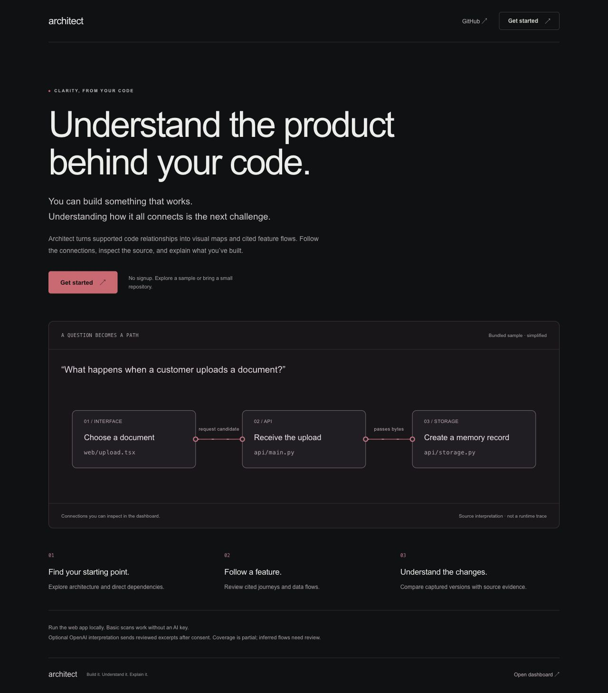
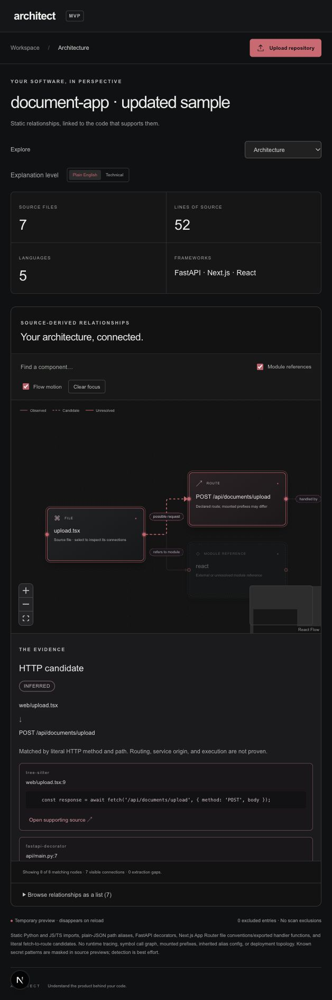
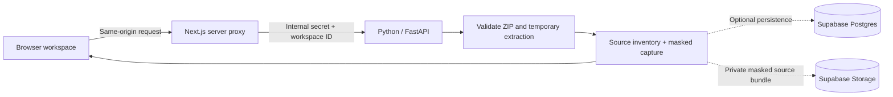

# Architect

### Understand the product behind your code.

**Turn “How does this work?” into a visual flow you can explore and check against the source.**

**Live demo:** [productarchitect.vercel.app](https://productarchitect.vercel.app) · **Repository:** [Harshakoliki/Architect](https://github.com/Harshakoliki/Architect)

## The problem: we can build software before we fully understand it

More of us want to build something: a side project, an internal tool, a startup, an idea we finally want to make real. Frameworks and AI coding tools can help us turn that idea into working code. But getting an application to run leaves another question: **do we understand how its parts work together?**

A page calls an API. The API invokes a handler. That handler reads data, calls another module, or sends something to an external service. Those connections are spread across files, languages and frameworks. As the project grows, following how the code communicates can become harder than finding the code itself.

A customer uploads a document. Which screen starts it? Which API receives it? Where do the bytes go? What feedback returns to the user? Which files should someone inspect before changing the feature?

For a solo builder, that can mean struggling to explain or extend something they have already shipped. For a new developer, it means searching for a starting point. For a founder or product manager, it means relying on someone else to translate the implementation. For a team, it can mean repeating the same explanation every time a person joins or a feature changes.

**Building creates code. Understanding requires seeing the connections.** When product knowledge is scattered across files, documentation and people's memories, understanding the product becomes repeated detective work—especially when parts of it were generated or built by someone else.

## The solution: make the connections visible

Architect turns supported source relationships and cited product interpretations into an interactive visual workspace. Upload a small repository ZIP, explore the parts and their connections, ask a flow question, and click a card or line to inspect the source behind it.

For example, ask **“Show me everything involved when a customer uploads a document.”** The bundled demo opens an inferred path from file selection to an API candidate, an in-memory record, and user feedback. Each step has supporting source links, and missing context stays visible.

Switch between **Plain English and Technical** to explain the same map at different levels of detail. Run the web app locally for source scanning; optional OpenAI interpretation sends reviewed excerpts only after explicit consent.

The product vision connects six perspectives: **architecture, user journeys, data flows, feature relationships, dependencies, and evolution**. The current checkpoint includes all six at a documented, limited depth. Evolution compares explicitly captured versions; automatic refresh and Git history remain planned.

## The payoff: a clearer starting point, a shared explanation

| When you need to… | Architect helps you… | Why that matters |
|---|---|---|
| Get oriented in unfamiliar code | Find supported modules, routes and their direct connections | Begin with a navigable map and relevant source |
| Understand a feature | Follow a proposed user journey or data flow with citations | Connect implementation details to a product action |
| Discuss a change | Inspect direct dependencies and unresolved boundaries | Bring concrete connections and open questions to the review |
| Explain the product to someone else | Switch explanation level while keeping the same evidence | Give developers and nontechnical teammates a common reference |
| Check an explanation | Open the source behind a card, connection or answer | Review the reasoning before relying on it |
| Understand what changed | Compare captured versions and open each version’s source | Keep earlier implementation context in the discussion |

These are the outcomes we are building toward and validating. We have not measured time savings, reduced defects, or team adoption. Static relationships and inferred journeys cannot establish complete change impact or runtime behavior.

**Our promise: make the product easier to understand, and make the explanation inspectable.**

## Try the current MVP

This repository contains the **Phase 6 MVP checkpoint**. The no-key demo scans actual bundled source, displays charcoal wireframe cards with red connections, and demonstrates cited product flows and a limited sample question finder.

> **Status — 10 October 2026:** architecture/dependency explorer, source inventory, evidence inspector, feature/source map, user journeys, data flows, flow questions, and Plain English / Technical presentation are implemented. OpenAI integration is tested with the actual SDK against mocked provider responses; **a live OpenAI call remains unverified because no API key is configured**. The no-key product example is hand-authored and its question finder uses limited lexical matching. Captured-version comparison is implemented; GitHub ingestion, commit history and automatic refresh remain planned. Optional Supabase persistence awaits the owner's separate project. Vercel production demo is live and checked; hosted operation sends source to the server.





[See the captured-version comparison](outputs/architect-phase-5.jpg). The landing screenshot uses the current wordmark. The dashboard screenshot is refreshed at each UI checkpoint; older verification reports retain their historical screenshots.

## Download and manage results

- Open a scan and choose **Download Markdown** for a readable report or **Download JSON** for structured data. The download includes the source graph, confidence, gaps, capture ID/time, original source hashes, file inventory, and the current product interpretation if one has been generated.
- Markdown connections and product steps link to an evidence section with path, line range, extractor and source hash. Full source contents and the reviewed OpenAI snippet bodies are excluded. Filenames and generated explanations remain; review the file before sharing. Downloads are created in the browser and do not make another provider call.
- Use **Jump to component** for a readable close-up, **Fit map** to return to the overview, or the **Browse relationships as a list** disclosure for a keyboard-friendly alternative. Cards and connections also accept keyboard selection. Source evidence opens in a modal dialog; Tab stays inside, Escape closes it.
- With Supabase configured, **Saved scans → Delete** asks for confirmation, removes the private source capture first and then its metadata, and clears the matching open preview/comparison entry. Ownership is checked using the workspace cookie before deletion. Missing scans are treated as already removed. Failures do not show success; retry if source was removed before metadata cleanup failed.
- Deletion does not revoke downloaded/shared copies or clear provider backups. There is no account recovery: losing the browser workspace cookie loses access to its saved scans. Without Supabase, previews remain temporary and disappear on reload.

## What works today

| Capability | Current behavior |
|---|---|
| Repository input | ZIP upload, up to 3 MiB compressed / 20 MiB expanded / 3,000 entries |
| Samples | Original and changed document-upload source fixtures, scanned by the real scanner |
| Version comparison | Up to eight snapshots in the open dashboard, capture-time timeline, file and supported connection changes, before/after maps, version-specific source |
| Safe scanning | No repository execution or dependency installation; rejects unsafe ZIP paths, duplicate entries, encrypted files, and symlinks |
| Inventory | Real file/line counts, languages, and manifest-based framework detection |
| Visualization | Interactive architecture/dependency graph, zoom/pan/focus, component jump, keyboard relationship list, restrained red motion and searchable inventory |
| Export | Browser-generated Markdown/JSON with capture IDs, hashes, confidence, gaps and source references; full source excluded |
| Deletion | Confirmed, workspace-scoped saved-scan/source deletion; partial failure is explicit and retryable |
| Static analysis | Python AST and tree-sitter JS/TS imports, plain-JSON path aliases, FastAPI route declarations, basic Next.js App Router route/page conventions |
| Honest gaps | Unresolved imports, parser failures, dynamic boundaries, and an explicit candidate label on HTTP method/path matches |
| Product interpretation | Optional OpenAI feature proposals, user journeys, and data flows; every generated feature/step/transition must cite available source excerpts |
| Sample product views | Hand-authored, validated document-upload and fingerprinting example; explicitly labeled as not an OpenAI result |
| Questions | Source-grounded OpenAI answers after consent; limited annotated-sample flow finder without a key; uncertain requests do not open a flow |
| Explanation level | Plain English or Technical card detail; stable graph identity, selection and evidence |
| Evidence | Captured source viewer with line numbers, original file SHA256, and best-effort masking of known secret patterns |
| Persistence | Optional private Supabase source storage and server-only scan metadata; preview mode works without credentials |
| Workspace boundary | Random browser session cookie scopes saved scans; no account signup |
| Presentation | Minimal landing page → Get started → dashboard; charcoal/red maps, plain text product name, keyboard focus and reduced motion |

**Architecture edges carry explicit meanings:** `imports`, `references`, `implemented by`, and `HTTP candidate`. Observed relationships, inferred candidates, and unresolved links are labeled. The separate inventory diagram means “contains.” Neither view is a runtime execution trace.

## Quick start

### Requirements

- Node.js **20.9+**, npm, Python **3.12+**, and [uv](https://docs.astral.sh/uv/getting-started/installation/).
- No OpenAI or Supabase key is needed to try the demo in temporary preview mode.
- macOS/Linux launcher. On Windows, run the two services manually with your virtual environment's Python path.

From the repository root:

```bash
cd backend
uv sync --python 3.13
cd ../frontend
npm ci
cd ..
python3 dev.py
```

Open **http://127.0.0.1:3000** and click **Get started** to enter `/dashboard`. The Python API runs on port 8000. The launcher creates an in-memory internal service secret and passes it to both services. Press Ctrl+C to stop them.

For configuration, copy `.env.example` to `.env` at the repository root. The launcher reads it. Keep real credentials out of Git. Shell environment variables take precedence over `.env`.

### Demo in two minutes

1. On the landing page click **Get started**, then **Explore sample**. This scans actual files from `backend/fixtures/document-app/`.
2. See seven real source files, three parsed source modules, and six extracted relationships.
3. Select `web/upload.tsx`; choose **Focus this component** to zoom into its neighborhood.
4. Click the red **HTTP candidate** connection to `POST /api/documents`. The evidence inspector shows both the literal frontend fetch and the FastAPI route. The inferred label explains what the match does not prove.
5. Click **Open supporting source** to see the relevant captured line highlighted.
6. Click the `api/main.py` → `api/storage.py` **imports** line: this is an observed Python import, with exact source evidence.
7. Switch to **Dependencies** to hide route candidates and examine module references. Use **Overview** for folder filtering and file search. On smaller screens, use the **Explore** selector.
8. Toggle **Flow motion** off, or use system reduced motion. The map supports zoom, pan, fit, search, a minimap, and a relationship list.
9. Open **User journeys** and choose **Explore annotated sample**. Follow document selection → HTTP candidate → in-memory record → feedback. The provider label explicitly says no AI call was made.
10. Switch to **Data flows** and choose **Document fingerprinting** to see bytes → identifier. Open any card or connection to inspect its supporting source excerpt.
11. Open **Feature relationships** to see candidate features connected to their cited files. Shared source does not establish a feature-to-feature dependency.
12. In a product view, use **Try: customer uploads a document**, click **Explore flow**, review the citations, and click **Open this flow**. Try **Show document** to see a clarification, or **Show document upload data** to open the data-flow view.
13. Switch **Plain English / Technical** above the map. The same nodes and selected evidence remain; descriptions, source-path detail and static connection wording change.
14. Open **Live changes**, then **Try updated sample**. Compare one added file, one removed file, three modified files, and eight supported relationship changes (three added, two removed, three with updated evidence).
15. Use **Before source / After source** on `api/main.py` to inspect the original `/api/documents` route and the changed `/api/documents/upload` route. Switch **Before map / After map** to see removed and added declarations. Capture times are not commit dates.
16. Upload another small repository ZIP to inspect real supported source relationships. In Live changes, **Upload next version** retains both scans for comparison. Configure OpenAI privately to generate product views for that upload.

The fixture's SQL schema is intentionally unconnected to its in-memory storage. The analyzer does not invent a database connection just because a SQL file exists.

### Enable OpenAI product views — optional

1. Copy `.env.example` to `.env` in the repository root.
2. Set `OPENAI_API_KEY` in that ignored file, **never in chat, browser fields, source code, or Git**.
3. Keep `OPENAI_MODEL=gpt-6.1-sol` or select another Responses model with Structured Outputs support available to your API project. The default was checked against official documentation on 2026-10-10; account access has not been verified.
4. Restart `python3 dev.py`, open a scan, and select User journeys, Data flows, or Feature relationships.
5. Expand **Review the source bundle** to inspect precisely which excerpts are selected. Check the consent box, then click **Build product views with OpenAI**.

The API receives at most 12 excerpts / 48 KB of context. Selection prioritizes declared-route/HTTP-candidate source and then supported code files; excerpts are bounded to 100 lines and 6,000 bytes. This is partial coverage, not a complete repository reading. Known secret patterns are masked again before transmission. Source, comments, and filenames are treated as untrusted data; no model tools or repository execution are available.

One foreground Responses call uses `store=false`, a 45-second SDK timeout, no automatic retries, and a 6,000-output-token cap. One call may be in flight per Python process. The app records returned model/token usage and verifies citation membership plus flow endpoint/step identity before attaching a result. These checks do **not** establish that AI prose is factually correct. All product interpretations remain inferred. [OpenAI Structured Outputs](https://developers.openai.com/api/docs/guides/structured-outputs), [OpenAI data controls](https://developers.openai.com/api/docs/guides/your-data).

Results are cached in the currently open browser scan only. Layer switching reuses them; reload/reopening requires regeneration. They are not persisted to Supabase in this phase. `store=false` does not guarantee zero provider retention. A user-initiated regeneration may incur another API charge. Missing keys, refusal, invalid citations, incomplete output, and provider failures preserve the static map.

### Ask a flow question

Open User journeys, Data flows or Feature relationships after building product views. Questions select an existing feature/flow and return supporting excerpt links; **Open this flow** navigates to that view. They do not generate new steps or execute the application. Unsupported or ambiguous responses carry no navigation target.

The bundled annotated sample uses a **limited lexical flow finder, not AI**. It recognizes document upload/fingerprinting and data-flow intent; it cannot diagnose failures, security, latency or runtime behavior. Arbitrary repository questions use OpenAI after separate consent to transmit the question, existing interpretation and reviewed source bundle. Requests are bounded to 128 KB, questions to 500 characters, and use the same timeout, store=false, single-call lock and output limits as interpretation. Returned citations and feature/flow indexes are checked before navigation. Valid references do not prove the answer is true. The existing interpretation itself is inferred, and the supplied browser snapshot is not server-attested.

Plain English uses explanatory card descriptions and friendlier static connection labels. Technical uses cited paths/line numbers and available code previews. Both retain uncertainty labels, source access, graph IDs and current selection. This is a presentation switch, not a claim of different analysis quality.

### Compare versions — no API key needed

Each successful scan or reopened saved scan enters the comparison tray, up to **eight snapshots**. Open Live changes, select Before and After, then inspect changed files, connections or either map. Comparison runs in the browser over already captured scans; it makes no extra OpenAI call or upload.

- File changes use paths and original SHA256 values. A rename appears as a removal and an addition.
- Connections are compared by source, target and relationship kind. Moved route declarations retain their logical identity; changed evidence/line positions are labeled as updates, not automatically as new behavior.
- Different or missing analyzer versions allow file comparison but withhold structural differences.
- Each source link opens that version’s captured content and hash. Product interpretations stay attached to their own scan and are not carried into new code as verified explanations.
- The timeline is ordered by **capture time**, not Git commit time. Repository lineage is not verified: choose versions of the same codebase.
- The comparison tray lives only in the open dashboard. Reloading or navigating away clears it. Optional Supabase saves individual scans; reopen the desired scans to rebuild a comparison. **Remove from tray** removes only the in-memory comparison entry, not a saved server scan.
- No automatic watcher, Git history, feature-level semantic diff, runtime observation or explanation of why a change happened is implemented.

### Create a small upload example

For an existing repository, remove secrets, dependencies, generated outputs, large binaries, and unnecessary files **before** creating a ZIP. Architect skips common credential files during analysis, but the complete archive reaches the server before those exclusions are applied.

The downloadable GitHub source ZIP of a small public repository also works. A sole outer ZIP directory is normalized away. Large repositories are outside this MVP limit.

## Architecture



- **Next.js + TypeScript** render the application and proxy a fixed set of API routes. No service or Supabase secret is exposed to the browser.
- **FastAPI + Python** validate uploads, read source, detect languages/frameworks, parse supported imports/routes, mask common secrets, and return real evidence graphs.
- **Supabase Postgres** stores scan metadata, the evidence graph, and file inventory. **Supabase Storage** stores a gzip-compressed JSON bundle of captured, masked source. The original ZIP is not persisted.
- Snapshot comparison is a pure browser-side diff; it reuses the existing graph canvas and source viewer. No comparison database, background job or additional provider call is needed.
- Scanning happens within the active request. There is no daemon, detached job, or persistent server disk dependency.
- Without Supabase configuration, results remain in the page's memory. Reloading loses the preview. Temporary extraction directories are removed after scanning.
- Stopping the browser wait does not guarantee server work or an already-started save is canceled.

### Repository layout

```text
frontend/app/                  Browser interface and server proxy
backend/architect/             ZIP boundary, scanner, analyzer, OpenAI product views, API, Supabase adapter
backend/fixtures/document-app/ Source-only sample; never auto-executed
backend/fixtures/document-app-v2/ Known changed sample for version comparison
frontend/lib/history.ts         Browser-side snapshot comparison
frontend/tests/                 Focused comparison tests
backend/tests/                 Security, scanner, API, and persistence-boundary tests
supabase/migrations/           Backend-only database/storage setup
outputs/                       TRD, phased plan, design decisions, verification report
visual-product-intelligence-prd.md  Original product vision and competitor research
.env.example                   Configuration names; no real secrets
dev.py                         Local two-service launcher
```

## Supabase setup — optional

Use a **separate project**, as selected by the owner. No unrelated Supabase project should be reused.

1. Create/provide that project in your Supabase dashboard.
2. Apply both files in `supabase/migrations/` in timestamp order using Supabase migrations or the dashboard SQL editor.
3. Set these **backend-only** variables:

```dotenv
SUPABASE_URL=https://YOUR_PROJECT.supabase.co
SUPABASE_SECRET_KEY=YOUR_SERVER_SECRET_KEY
```

New `sb_secret_...` keys are sent in the `apikey` header. Legacy service-role JWT keys are also supported. **Do not use an anonymous/publishable key here. Never prefix a secret with `NEXT_PUBLIC_`.**

The migration enables RLS, removes browser-role table grants, and creates a private storage bucket with no browser access policy. The server key bypasses RLS, so the backend also filters **every read by the workspace identifier**.

The workspace identifier is a random, HTTP-only, SameSite cookie lasting 30 days. It is an anonymous bearer capability, not an account. Clearing cookies or changing browser loses access to that workspace's saved scans. Account recovery, collaboration, and mature abuse controls are deferred.

## Vercel deployment

**Production demo:** [https://productarchitect.vercel.app](https://productarchitect.vercel.app). Deployed and verified on 10 October 2026 in `Harsha Koliki’s projects` (Hobby), project `architect`.

The root `vercel.json` deploys one **Vercel Services** project with two independently built services:

- **frontend:** Next.js from `frontend/`, receives all public paths, including the same-origin `/api` proxy.
- **backend:** FastAPI from `backend/`, reachable only by the frontend’s service binding. There is no public rewrite to the backend.
- Vercel injects `ARCHITECT_BACKEND_URL` into the frontend at runtime. Do not set this variable manually in Services mode.
- Set one random **server-only** `ARCHITECT_SERVICE_SECRET` of at least 32 characters for Production and Preview. Both services receive it; the backend still verifies application-level authorization and workspace scope.
- Optional `SUPABASE_URL`, `SUPABASE_SECRET_KEY`, `OPENAI_API_KEY` and `OPENAI_MODEL` can be configured privately. They must never use `NEXT_PUBLIC_`. Hosted operation sends source to Vercel; optional providers add their disclosed boundaries.

Import `Harshakoliki/Architect`, choose the Services preset and repository root `./`, and deploy the reviewed main commit. This supersedes the original two-project setup. Services is currently beta, available across Vercel plans; usage is subject to the account’s included limits and service-request accounting. [Configuration](https://vercel.com/docs/services/config-reference), [bindings](https://vercel.com/docs/services/bindings), [pricing](https://vercel.com/docs/services/pricing).

The 3 MiB ZIP limit leaves room beneath Vercel’s documented 4.5 MB request-body limit. Large scans need a direct private upload and a durable worker, which are deferred. This MVP has no user accounts, durable quotas or complete abuse controls. Use the bundled sample or a small public repository for a public demo; do not upload sensitive code.

**Deployment status:** Ready. Hosted health, real public-fixture ZIP upload, invalid ZIP rejection, sample product views, flow questions, audience switching, and version-specific comparison evidence passed. OpenAI and Supabase remain unconfigured; the hosted demo uses temporary browser previews and the annotated no-key sample. See [deployment verification](outputs/deployment-verification.md).

## Privacy and trust

The original product vision is local-first. The owner subsequently selected Vercel + Supabase for this web MVP. These modes have different data boundaries:

| Mode | Where source goes |
|---|---|
| Local preview | Local browser and local Python server; no Supabase or OpenAI calls |
| Hosted preview | ZIP is uploaded to the hosted analysis service; results return to the browser |
| Hosted + Supabase | Captured masked source and metadata are stored in the configured cloud project |
| Optional OpenAI mode | Listed source excerpts go to OpenAI only after the consent checkbox and a generation click |
| Future local companion | Browser connects to a local reader; code can remain on the user's computer |

**Do not describe the hosted mode as “code never leaves your computer.”**

Current protections include bounded uploads/expansion, unsafe-path rejection, symlink rejection, ignored generated/credential directories, nested `.gitignore` rules, UTF-8/text checks, no analyzed-code execution, captured-source evidence, and server-only credentials. Known secret patterns are masked in displayed/persisted content, but secret detection is best effort. It does not make uploading a sensitive repository safe by itself. Filenames may also contain sensitive information.

No telemetry, remote fonts, or GitHub authorization flows are implemented. Basic scans and the annotated example make no OpenAI requests. Opt-in OpenAI interpretation uses the separate boundary described above. Dependency installation and deployment providers have their own network behavior. Saved-scan deletion removes the captured source object and metadata in the current workspace, with confirmation and retry on partial failure. Provider backup retention is outside this control; do not upload private repositories to a public hackathon instance.

## Roadmap and phase gates

After each phase, explain what works, demonstrate it, report checks and limitations, and wait for the owner's confirmation.

| Phase | Result | Status |
|---|---|---|
| 1 — Foundation | ZIP/sample scan, real inventory, source viewer, UI, optional Supabase | Built; verification report accompanies handoff |
| 2 — Architecture & dependencies | Parse supported code relationships; evidence-backed graph | Built; narrowed static coverage documented below |
| 3 — Product meaning | OpenAI-assisted feature, journey, and data-flow views | Built; live provider verification pending a private key |
| 4 — Ask & explain | Natural-language flow exploration; technical/nontechnical switch | Built; sample/UI verified, live provider verification pending |
| 5 — Evolution | Captured snapshot timeline, file/connection diffs, version-correct evidence; minimal landing page | Built; Git history and automatic refresh deferred |
| 6 — Complete demo | Keyboard/source-dialog improvements, readable map jump, evidence-linked Markdown/JSON, workspace-scoped deletion, clearer API errors | Built; live Supabase deletion verification awaits the separate project |

### Future access methods

**ZIP first:** fastest onboarding for a hackathon, requires re-upload for updates.

**Read-only GitHub App next:** install on selected repositories, read contents and metadata only, select branch/commit, refresh from webhook events, support revocation. Avoid broad personal access tokens. This does not execute or push to the user's repository. It still requires authorization, token lifecycle management, and webhook verification.

**Local companion later:** install a small local reader for filesystem access and change watching. The hosted browser cannot read arbitrary laptop folders. The companion needs explicit folder selection, origin validation, pairing, loopback binding, update distribution, and a clear policy for what can leave the machine.

## Next product phase

The approved six-phase MVP is implemented at the limited depth documented here. Next, connect the owner’s separate Supabase project and private OpenAI key, then verify persistence, deletion and actual model quality. Read-only GitHub ingestion and a local companion are separate later product phases.

## Verification

```bash
cd backend
uv run pytest -q
uv run ruff check architect tests main.py
cd ../frontend
npm run typecheck
npm test
npm run build
```

Tests cover safe extraction, expansion/upload limits, duplicate paths, secret masking and line preservation, ignore rules, real sample/upload scanning, API service/workspace boundaries, Supabase read scoping, and failed-save preview behavior. Live cloud persistence and deployed-provider behavior require a configured separate project and real deployment.

Phase 5 checks: **35 backend tests, six comparison tests, backend lint, frontend type checking and production build passed**. Browser checks covered landing → dashboard, both source versions, changed connection evidence, before/after maps and the same-snapshot empty state.

Phase 6 checks: **41 backend tests, 10 frontend tests, backend lint, frontend type checking and production build passed**. Export tests verify linked evidence, Markdown escaping, confidence/gaps/hashes and source-body omission. Deletion tests verify workspace scoping, invalid IDs, private API boundaries and partial failures. Live provider verification is still pending.

See [`outputs/phase-6-verification.md`](outputs/phase-6-verification.md) and [`outputs/phase-5-verification.md`](outputs/phase-5-verification.md) for the handoff results. Coverage is deliberately narrow; it is not a security audit or proof that arbitrary repositories are completely understood.

## Known limitations

- Imports and selected declared routes are mapped. Product views are bounded interpretations over selected excerpts. No symbol-level call graph, complete repository understanding, watcher, Git history, or GitHub ingestion yet.
- Live OpenAI behavior/quality is unverified without an API key. The bundled annotated sample is hand-authored and cannot be applied to a different repository. Provider tests use mocked responses through the actual SDK.
- Feature relationships currently show candidate features and shared supporting source files. They do not infer feature-to-feature dependencies. Flow citations reference complete selected excerpts, not claim-specific individual lines.
- Static resolution is bounded: no inherited tsconfig/JSONC alias expansion, package export maps, `.js` to `.ts` substitution, arbitrary Python sys.path inference, dynamic import targets, mounted route prefixes, middleware tracing, Next.js Pages Router, aliased/arrow route-handler exports, or runtime topology.
- External/reference nodes show source imports; they do not establish installed dependencies. HTTP candidates match a unique method/path pair; origin, rewrites, auth, runtime execution, and deployment remain unknown.
- The graph canvas shows at most 120 matching nodes; search narrows the graph. Gap examples are bounded in the UI. Large codebases require aggregation and a durable analysis worker.
- Framework detection comes from supported manifests; it does not prove runtime usage. Only documented Python and JS/TS patterns receive semantic extraction; other languages remain inventory-only.
- UTF-8 text only; binary, large, generated, and unsupported files are omitted. The skip report is bounded to 200 examples.
- Nested `.gitignore` is supported; submodule resolution and full Git global ignore semantics are not.
- Original source hashes identify uploaded bytes; displayed/saved contents may be masked and therefore differ from that hash. Masking preserves line positions for recognized patterns.
- Snapshots describe captured source, not observed production execution or runtime traces. Comparison is session-only, bounded to eight entries, and does not verify repository lineage. A source/evidence update is not proof of a behavior change.
- Supabase outages preserve a temporary preview and show a warning; they do not produce a false successful-save state.
- The frontend shows the first 60 matching files and loads more on demand; source is paged in 200-line sections.
- No multi-user account guarantees, durable background processing, or public resource quotas in this phase.

## Product documents

- [Product requirements and market research](visual-product-intelligence-prd.md)
- [Technical requirements and current hosting amendment](outputs/architect-mvp-trd.md)
- [Six-phase implementation plan](outputs/mvp-build-plan.md)
- [Visual direction and reference decisions](outputs/design-direction.md)
- [Product story and reusable pitch](outputs/product-story.md)

The original PRD/TRD contain the broader vision. The hosting amendment and this README describe the current implementation. Roadmap statements are not completed features.

## Primary technical references

Research/configuration review as of **2026-10-10**:

- [Next.js installation](https://nextjs.org/docs/app/getting-started/installation)
- [FastAPI](https://fastapi.tiangolo.com/)
- [Vercel FastAPI support](https://vercel.com/docs/frameworks/backend/fastapi)
- [Vercel function limits](https://vercel.com/docs/functions/limitations)
- [Supabase API keys](https://supabase.com/docs/guides/getting-started/api-keys)
- [Supabase Storage access control](https://supabase.com/docs/guides/storage/security/access-control)
- [Supabase changelog](https://supabase.com/changelog)
- [React Flow documentation](https://reactflow.dev/learn)
- [Tree-sitter](https://tree-sitter.github.io/tree-sitter/)
- [OpenAI Structured Outputs](https://developers.openai.com/api/docs/guides/structured-outputs?api-mode=responses)

## Hackathon submission checklist

- [x] Publish the public repository: https://github.com/Harshakoliki/Architect
- [x] Install dependencies and run both services locally on macOS; fresh-machine setup has not been independently checked.
- [x] Include a screenshot or short recording of the real sample/upload flow.
- [x] Deploy and test the live URL: https://productarchitect.vercel.app
- [x] Describe Phases 1–6 as implemented, with live OpenAI and Supabase verification explicitly pending.
- [ ] Confirm the competition's own eligibility, disclosure, and submission rules.

The owner supplied the Bengaluru build-board submission form. It accepts GitHub/demo/video/website URLs and asks for name, email, Indian mobile number, project title, description, and publication consent. The owner is submitting personally; this repository does not claim that a submission was made. Full competition eligibility rules have not been verified.
