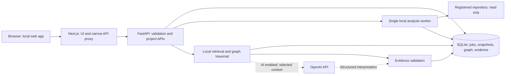

# Architect — Technical Requirements Document

**Version:** 0.1, implementation baseline
**Date / documentation checked:** 10 October 2026
**Status:** Phases 1–2 implemented; later phases await approval. Section 0 and the README define current behavior.
**Product:** Visual Product Intelligence, working product name Architect
**Companion documents:** [Product requirements](../visual-product-intelligence-prd.md), [six-phase build plan](mvp-build-plan.md)

## 0. Hosting amendment — current implementation baseline (2026-10-10)

The owner selected **Vercel + Supabase** after the initial local-web design below. This amendment supersedes conflicting runtime, ingestion, persistence, job, privacy, and history requirements in Sections 1–5, 7–8, 13–16, and 18–20. The remaining original sections document the planned full MVP, not delivered MVP behavior. See the root README and phase verification report for implemented features.

### Current stack and input

- Next.js/TypeScript browser application and fixed-route server proxy, prepared for one Vercel project.
- Python/FastAPI analysis service, prepared for a second Vercel project. Local development uses both processes on loopback.
- ZIP ingestion first; no absolute-path endpoint is exposed to hosted browsers. Read-only GitHub App and local companion are separate later work.
- Limits: 3 MiB compressed, 20 MiB declared expanded, 3,000 archive entries, 1 MiB per captured file. Reject unsafe/duplicate paths, symlinks, encrypted entries, and unreadable archives before analysis. Existing source ignore and redaction rules apply.
- The original ZIP reaches the server. Credential-file exclusion happens after upload. UI must disclose this before submission of an archive.

### Persistence and source evidence

Supabase Postgres `architect_scans` stores scan ID, workspace ID, name, summary, inventory, source key, and capture time. A private `architect-source` bucket stores gzip JSON of masked captured source. The original ZIP is discarded. RLS is enabled and browser-role table grants are revoked; server secret/service-role access only. Every read also filters by workspace because server credentials bypass RLS. Source content is never fetched by arbitrary filesystem path.

Without configured Supabase variables, scanning works in explicitly labeled temporary preview mode. The backend keeps no persistent copy, the browser retains the result until reload, and extraction uses an automatically removed temporary directory. Missing or failed persistence must never be shown as saved.

A random 256-bit HTTP-only SameSite cookie selects an anonymous browser workspace. The Next server forwards it with a separate internal service secret. This avoids account signup but is not a complete user identity/recovery or abuse-control system. The secret and Supabase credential must never enter browser bundles or error details. Hosted private-code demos need controlled access. Public unrestricted uploads are outside Phase 1.

### Serverless request lifecycle

A scan is owned by its active bounded HTTP request. NDJSON announces actual scanning and saving stages and then emits a complete result or a safe error. There are no synthetic percentages, detached worker processes, local durable jobs, or daemon watchers. Browser cancellation stops waiting; it does not promise cancellation of already-started server work. Larger ingestion requires direct private uploads plus a durable worker and is deferred.

### History and privacy changes

Uploaded ZIP snapshots have no assumed Git metadata or local live watcher. Phase 5 initially compares explicitly uploaded states. Commit history, webhook refresh, and chronological commit attribution require the later read-only GitHub integration. A local companion is the later option for on-device source and file watching. Hosted Vercel/Supabase operation is cloud execution/storage and cannot retain the original “code never leaves the device” promise. Phase 1 makes no OpenAI calls; future API-assisted interpretation adds a separately disclosed boundary.

### Actual Phase 1 acceptance

Sample and uploaded source scan; actual languages/frameworks/counts appear; a 2D folder containment map and searchable list open captured line-numbered source; unsafe ZIPs fail safely; no analyzed source executes; known secrets are masked; optional saves are workspace-scoped; missing cloud configuration produces an honest usable preview. The six semantic views remain disabled and visibly upcoming. Cloud persistence/deployment acceptance is pending the owner's separate project and live verification.

### Deployment and submission

Use `backend/` and `frontend/` as separate Vercel roots with matching internal service secrets and an HTTPS backend origin on the frontend. Preserve provider request/runtime constraints. README must include exact setup, data boundaries, demo steps, completed scope, deferred features, test results, and real repository/deployment URLs only after verification.

Current references: https://vercel.com/docs/frameworks/backend/fastapi ; https://vercel.com/docs/functions/limitations ; https://supabase.com/docs/guides/getting-started/api-keys ; https://supabase.com/docs/guides/storage/security/access-control .

---

**Original local-web design below — superseded where this amendment differs.**

## 1. Purpose and implementation agreement

This document defines how to build a functional, visually appealing web MVP that reads an authorized local codebase and helps people understand it through six connected visual views. The core outcome is a useful, inspectable account of the code. Product explanations must be traceable to source evidence, and visual flows must remain readable as detail increases.

Implementation uses **Next.js and TypeScript for the frontend, Python and FastAPI for the backend, SQLite for local storage, and OpenAI APIs for interpretation and natural-language answers**. This replaces the PRD's desktop application baseline with a web interface served on the user's own computer. It also replaces local-model experimentation with optional OpenAI integration. The PRD's evidence and privacy principles still apply, with the explicit exception that enabling OpenAI sends selected context off-device.

Build the six phases in the agreed order. After each phase, demonstrate what works, explain it in plain English, report checks and limits, describe the next phase, and **wait for the user's confirmation before starting that phase**. A defect in the current phase can be repaired without treating it as a new phase. This TRD is preparation, not completion of Phase 1.

### Definition of the finished MVP

A user can open a real supported repository, explore architecture, journeys, data flows, feature relationships, dependencies, and changes; switch technical/nontechnical explanation; ask a feature-flow question; inspect source evidence; compare indexed versions; and export a useful report. The interface is visually reviewed against the supplied references, not merely accepted because every button exists.

### Scope boundaries

- One local user, local browser, one repository per exploration context; multiple saved projects may exist.
- No account system, billing, multi-user permissions, cloud repository ingestion, hosted deployment, or team collaboration.
- No execution of the inspected repository, dependency installation, code edits, builds, production tracing, or automated security certification.
- Narrow documented parser/framework support, with explicit partial coverage elsewhere.
- OpenAI helps explain and interpret evidence. Its output never silently becomes a verified code fact.

## 2. Architectural decisions

| Decision | MVP choice | Reason and boundary |
|---|---|---|
| User interface | Next.js App Router, React, TypeScript | Web UI requested; interactive graph is a client component [T1] |
| API / analysis | Python + FastAPI + Pydantic | Typed input/output contracts; Python handles code analysis and OpenAI |
| Database | SQLite through Python's standard library | No database service to install; typed SQL and parameterized queries |
| Graph storage | Nodes, edges, evidence in relational tables | Bounded traversals fit MVP; no graph database server |
| Graph UI | React Flow (`@xyflow/react`), small layout dependency only if necessary | Pan, zoom, selection, custom nodes, and accessibility support [T5] |
| JS/TS parsing | Tree-sitter Python bindings with pinned grammar packages | Structured syntax extraction; parser does not execute source [T4] |
| Python parsing | Standard-library `ast` | Imports, definitions, calls, and recognizable FastAPI decorators |
| Search | SQLite FTS5 if present, bounded lexical fallback | Local search; embeddings/vector storage deferred [T7] |
| AI | OpenAI Python SDK, Responses API, structured response schema | Validate the response shape and evidence IDs; factual checking remains separate [T8] |
| Long work | Single local analysis worker process, persisted job status | Keep CPU/file work off request handling; no Redis/Celery deployment |
| Browser progress | Poll job status while active | Small, reliable first implementation; no WebSockets requirement |
| History | Git object reads plus stored working-tree snapshots | Read old source without changing the user's checkout [T10] |
| Deployment | Two local processes, one browser-facing origin | Next.js on loopback, Python on loopback; not a public service |

Pin compatible maintained dependency versions during Phase 1 and commit lockfiles. Do not guess a version matrix in this document. Verify parser/grammar compatibility before installing. Start with a small set of dependencies; add packages only when a concrete required behavior justifies them.

## 3. Runtime architecture and trust boundaries



**Repository boundary:** Only explicitly registered project roots may be analyzed. Every source lookup is project/snapshot/evidence-scoped; no endpoint accepts an arbitrary source path to read. Resolve and validate paths, skip symlinks, and never recursively follow them outside or inside the project in MVP. The app's database/cache directories are excluded if they sit beneath a selected root.

**Browser boundary:** The browser receives graph results and requested evidence, not the OpenAI key or unrestricted filesystem access. A browser cannot hand the server permission to arbitrary folders on a different machine. The MVP therefore accepts a local path to the machine running Python. Native folder selection and repository uploads are deferred.

**Service boundary:** Next.js exposes a narrow, allowlisted `/api/v1` proxy to FastAPI. A per-launch internal service secret is generated by the launcher and injected into both servers; Next.js forwards it server-side. Python rejects calls without that header. This is process isolation, not a user login. Next.js validates loopback Host values and the exact app Origin on state-changing requests, accepts JSON for mutations, limits bodies, and does not forward arbitrary URLs/headers. Both processes bind only to loopback. No wildcard CORS or public development tunnel.

**AI boundary:** Only explicit OpenAI-enabled workspaces can send selected code context to the configured OpenAI endpoint. A local model, hosted repository upload, remote tool execution, shell tool, web-search tool, and hosted file search are not part of the implementation.

**Limits:** The MVP trusts the local OS user. It is not a hardened sandbox against a compromised computer or an adversarial local process. Public hosting would require authentication, authorization, an ingestion redesign, worker isolation, quotas, and a separate review.

## 4. Repository structure and ownership

```text
Architect/
  frontend/
    app/                  pages, layout, allowlisted API proxy
    components/           explorer, graph, evidence, questions, timeline
    lib/                  API types/client, URL state, graph display helpers
  backend/
    architect/
      main.py             FastAPI app and lifespan
      api.py              project, analysis, graph, evidence, question endpoints
      models.py           request/response contracts
      db.py               schema and specific SQL operations
      scanner.py          discovery, exclusions, source capture
      analysis.py         extraction orchestration and graph assembly
      parsers/            JS/TS and Python extraction
      jobs.py             worker lifecycle, claiming jobs, progress
      intelligence.py     retrieval, OpenAI calls, output validation
      history.py          snapshot and graph comparison
    tests/                parser, boundary, snapshot, AI-contract tests
    pyproject.toml
  fixtures/document-app/  clearly labeled sample source and answer key
  outputs/                PRD/TRD/build plan and user-facing review reports
  .architect-data/        ignored local database, blobs, logs
  .env.example            names/placeholders only; no real secrets
  README.md               setup, run, coverage, privacy limits
```

This is a responsibility map, not an instruction to create empty modules in advance. Create files when the phase needs them. Next.js owns rendering; Python owns ingestion, graph semantics, persistence, retrieval, and AI. Avoid duplicating analysis in TypeScript. Pydantic/OpenAPI contracts are the authority; keep TypeScript response types aligned and verify contract examples at the phase where they are introduced.

## 5. Ingestion and source capture

### 5.1 Project registration

1. User enters a local folder path and sees a concise privacy/coverage explanation.
2. Python canonicalizes it, verifies it is an accessible directory, rejects filesystem root and obvious credential/system directories, and assigns an opaque project ID.
3. Preview shows recognized languages/frameworks, exclusions, and estimated eligible file count/size. Preview is bounded; it does not parse or call OpenAI.
4. User starts indexing. This creates a persisted job and a staging snapshot.
5. Current valid snapshot remains visible until staging analysis completes and is atomically published.

The registration response can show the selected project root to its local user. Errors and logs must avoid dumping home-directory contents or credentials. Avoid duplicate registration of the same canonical root.

### 5.2 Discovery policy

Honor `.gitignore` rules with a tested Git-wildmatch-capable library for nested rules. Apply hard security exclusions before ignore negations. Exclude `.git`, `node_modules`, virtual environments, build caches, generated output, coverage, app data, `.env` variants, private keys/certificates, known credential files, and binary files. Excluded `.env.example` files can still contain secrets; exclude `.env*` consistently for MVP. Use safe manifest fields and lockfile summaries for technology/dependency names; do not index lockfiles as source symbols.

Read selected text types only, cap size, decode explicitly, and record skipped files by reason. A file with parse errors can contribute safe file-level information, but not resolved relationships from invalid regions. Re-read file metadata/hash when needed; a changing file gets a diagnostic/retry rather than a silently inconsistent snapshot. Enumeration and reads must use no-follow/containment checks, with a boundary test for symlink swaps where supported.

### 5.3 Initial operational limits

| Limit | Initial value | Behavior when exceeded |
|---|---|---|
| Eligible source files | 10,000 per scan | Stop with actionable message; preserve last valid snapshot |
| Individual source file | 1 MiB | Skip with reason |
| Captured source total | 100 MiB per snapshot | Stop before publishing partial result as complete |
| Directory nesting | 50 levels | Skip deeper subtree and mark coverage incomplete |
| Question | 2,000 characters | Validate before work starts |
| Source response | 200 lines per request | Require a bounded adjacent range |
| Visible graph response | 200 nodes / 400 edges | Group or mark truncated; expand by subject |
| Traversal | Depth 6 / 500 visited nodes | Return bounded results and a visible limit notice |

These are engineering defaults to benchmark, not promises of speed or exhaustive understanding. Avoid adding user-facing configuration screens for every limit. Central backend constants are sufficient until measured needs justify settings.

### 5.4 Immutable evidence source

Store content-addressed compressed text blobs locally for **included supported source files**. Evidence points to the captured blob/hash, not the current mutable file. Git snapshots also capture analyzed blobs so cited evidence survives a checkout change or Git garbage collection. File exclusion rules apply before capture. No remote blob store.

Store originals locally under OS file permissions, show a persistent explanation that the index contains code, and redact credential-like values in rendered snippets and AI context. Detection is best-effort; exclusions are the primary control. App-data encryption is deferred, so full-disk/OS access remains a residual risk. UI path to delete a project deletes its index; shared content blobs are removed when no retained snapshot references them.

## 6. Parsing and relationship extraction

### 6.1 Coverage matrix

| Source | MVP direct extraction | Conditional / inferred | Explicit gaps |
|---|---|---|---|
| JS, TS, JSX, TSX | Static imports/exports, definitions, explicit local calls where resolved | UI handler-to-API links and familiar client calls | Computed imports, full type inference, arbitrary decorators |
| React | Components and explicit event handlers/navigation | Human-readable feature labels from code/text | Runtime state, conditional display, all hook behavior |
| Next.js App Router | `page` routes, `route` handlers and HTTP methods | UI fetch to same-project route when method/path resolve | Rewrites, dynamic middleware, hidden deployments |
| Python | Imports, definitions, direct local calls | Recognizable FastAPI decorators/dependencies | Monkey patching, metaclasses, arbitrary dynamic dispatch |
| FastAPI | Router prefixes and route decorators when literal/resolvable | Explicit request/response transformations | Runtime-loaded routes and arbitrary dependency behavior |
| HTTP | Literal method/URL and supported client wrappers | Same-project API match or external-service boundary | Dynamically constructed paths and network behavior |
| Database | Prisma schema models and explicit Prisma calls; explicit SQLite calls | Read/write operation classification | SQLAlchemy parity, arbitrary ORM, full SQL lineage |
| Package/config manifests | Framework/package presence and explicit service hints | Architecture grouping | Actual production topology or active feature flags |
| Other text/languages | File inventory and safe metadata | Optional authored labels | No claims of parsed symbol/journey coverage |

Support specific syntax patterns with fixtures before listing them as supported. The MVP cannot become a universal interpreter. A framework/version not exercised in fixtures is partial support even if the file extension is recognized.

### 6.2 Import and call resolution

- Resolve relative JS/TS imports against supported extensions and index files. Support literal `baseUrl`/`paths` patterns from `tsconfig.json`; unknown/extended configurations generate a diagnostic rather than guessed resolution.
- Distinguish external package imports from unresolved local imports. Manifest presence proves a declared dependency, not a runtime call.
- Resolve Python package/module paths and explicit aliases within the selected root. External packages remain boundary nodes.
- Link calls only when the binding can be resolved through supported syntax. A matching function name alone does not prove a call target.
- Emit route-client relationships only when enough method/path information agrees. Overlapping/dynamic routes remain candidate matches.
- AST extraction must preserve scope so two functions with the same name are not merged.

### 6.3 Provenance classes

Keep **method**, **confidence**, and **human review** separate.

| Attribute | Values | Interpretation |
|---|---|---|
| Method | `parser`, `framework_rule`, `ai_inference`, `user_annotation` | How the claim was created |
| Confidence | `direct`, `corroborated`, `inferred`, `unknown` | Strength of evidence, not execution probability |
| Review | `unreviewed`, `confirmed`, `disputed` | User feedback, with authorship/time |

An explicit import is direct evidence that code references a module, not proof that a request executes it. An AI edge cannot be promoted to direct by the AI. Two copied snippets are not independent corroboration. Unknown means a boundary cannot be resolved; represent it as a gap, not a fabricated target edge. Do not calculate a percentage confidence in MVP.

Coverage is reported separately: eligible/captured/parsed/skipped/failed files, supported patterns, unresolved relationships, limits hit, and analyzer version. A count of scanned files is not a percentage of product understanding.

## 7. Graph model, identity, and storage

### 7.1 Graph semantics

Entity kinds: `file`, `module`, `symbol`, `screen`, `route`, `service`, `data_store`, `data_model`, `external_system`, `package`, `feature`, `journey`, and `gap`. Use a common node record with typed metadata rather than a separate table for every kind.

Relationship types and direction:

| Type | Source → target |
|---|---|
| `contains` | Module/file/group → contained item |
| `imports` | Importer → imported module/package |
| `calls` | Caller → resolved callee |
| `handles` | Route → handling symbol |
| `requests` | Client symbol/screen → API or external boundary |
| `reads` / `writes` | Operation/symbol → data model/store |
| `emits` / `consumes` | Producer → event; consumer → event |
| `implements` | Source symbol/module → product feature |
| `uses` | Feature → shared service/data/feature, with evidence |
| `step` | Journey → member node, order in metadata when known |

Do not imply temporal order from an import edge. Journey steps use ordinal/branch metadata only when evidence establishes it; otherwise show an illustrative inferred sequence with its label. Transitive dependencies mean reachable code relationships, not guaranteed breakage.

### 7.2 Identity and revisions

Project IDs are generated UUIDs. Node logical keys use project + kind + normalized relative path + scoped symbol/route identity. Snapshot-scoped rows pair `snapshot_id` with logical key. Line numbers and description text are excluded from identity so minor edits do not create new entities. Evidence IDs remain snapshot-scoped and immutable. Edge keys use endpoints, type, and callsite/relationship identity where required to distinguish parallel edges.

Exact-key comparisons are the baseline. A rename is a possible match based on source similarity/signature, never guaranteed continuity. Annotated items with uncertain matches become orphaned annotations requiring review. User-authored feature identity is persistent; AI-proposed grouping identity is not assumed stable across different model/prompt versions.

### 7.3 Minimum schema

| Table | Essential fields / constraints |
|---|---|
| `projects` | id, display_name, canonical_root, current_snapshot_id nullable, settings_json, created_at; unique canonical root |
| `jobs` | id, project_id, kind, status, stage, processed/total, diagnostics_json, cancel_requested, timestamps |
| `snapshots` | id, project_id, kind, commit_sha nullable, parent snapshot nullable, source_digest, analyzer_version, policy_hash, status, coverage_json, created_at |
| `files` | snapshot_id, file_id, relative_path, language, blob_hash, parse_status; unique snapshot/path |
| `nodes` | snapshot_id, logical_key, kind, label, attributes_json; composite primary key |
| `edges` | snapshot_id, logical_key, source_key, target_key, type, method, confidence, attributes_json; endpoint foreign keys |
| `evidence` | id, snapshot_id, file_id, start/end line, blob_hash, extractor_id; valid range checks |
| `evidence_links` | snapshot_id, entity_kind, entity_key, evidence_id; entity/evidence membership checked in write transaction |
| `annotations` | id, project_id, target_key, target_kind, content_json, review_state, last_resolved_snapshot, timestamps |
| `saved_views` | id, project_id, snapshot_id nullable, title, layer, focus_key, filters_json, audience, viewport_json |
| `ai_results` | id, project_id, snapshot_id, task_kind, request_hash, model_id, prompt/schema_version, result_json, usage_json, status, created_at |

Store source blobs by hash on disk with database references and garbage collection. A jobs record can reference its result snapshot/AI-result ID. Add an FTS5 virtual table for labels, relative paths, symbols, and safe descriptions; it is rebuilt from published snapshots and is not an independent source of truth. Do not embed raw source unnecessarily in search indexes.

Foreign keys enabled; parameterized SQL only; WAL on a local filesystem with bounded busy timeout and a serialized worker writer. Use transactions for publish, deletion, and interpretation attachment. SQLite WAL improves read/write concurrency but still requires write coordination. [T6] Schema migrations are numbered SQL files; advance the schema version only on success. Never silently recreate a user's database to fix a migration error.

## 8. Jobs, publication, and failure recovery

Job states: `queued → running → succeeded | failed | cancelled | interrupted`. Stages: discovery, capture, parsing, resolving, publishing; AI is a separate job so OpenAI failure does not invalidate static analysis.

FastAPI creates a job and returns `202`. One worker process claims queued jobs transactionally. Only one analysis runs at once in MVP; other requests can still query the last published snapshot. The worker updates counts/diagnostics after bounded batches. Polling every 1–2 seconds while active is sufficient. Display an indeterminate stage when a denominator is unknown; do not invent an overall percentage.

Publish snapshot rows and update the project's current snapshot pointer in one transaction after validation. Failed/cancelled staging snapshots are not queryable as valid product models. On restart, jobs left running are marked interrupted; the UI offers retry. Cancellation is cooperative between files/stages and stops an AI call when possible, without promising to reverse provider billing already incurred.

Use blocking parsing and filesystem work outside the API event loop, consistent with FastAPI's concurrency guidance. [T2] The lightweight local worker is a deliberate MVP boundary; distributed task infrastructure would be reconsidered for hosted/multi-user workloads. [T3]

## 9. OpenAI integration

### 9.1 Tasks and authority

| Task | Input | Allowed output | Cannot do |
|---|---|---|---|
| Feature proposal | Bounded routes, symbols, labels, evidence | Candidate features, member IDs, short rationale | Claim unsupported business intent as fact |
| Flow interpretation | Candidate graph paths and relevant snippets | Explanations, labeled inferred transitions, gaps | Invent source files or promote guesses to direct edges |
| Question planning | Question and candidate entities | Intent, candidate IDs, bounded filter suggestion | Execute SQL, shell, filesystem reads, or arbitrary tools |
| Answer explanation | Validated subgraph and evidence | Claim-level text and citation IDs | Establish runtime behavior without evidence |
| Nontechnical wording | Same evidence-backed claims | Simpler labels and explanations | Change claims or suppress uncertainty |

### 9.2 Request contract

Python calls the Responses API using a maintained SDK with structured Pydantic/schema output. Choose a currently available model with suitable code understanding and structured-output support when integrating, verify account access, then record the exact configured model. No routing among multiple providers or fine-tuning in MVP.

Set `store=false`, use foreground requests, and avoid hosted files, vector stores, background responses, remote tools, and provider-managed conversation persistence. `store=false` does **not** establish zero retention: provider abuse monitoring and other applicable policies still apply. The app must link to the current OpenAI data-controls documentation and make no zero-retention promise. [T9]

Start with one in-flight AI call per app, at most two calls per interactive question (planning only when needed, then explanation), a 60-second per-call timeout, at most one bounded transient retry with backoff, and no retries on invalid key/refusal/invalid evidence. Account for the SDK's retries so they do not multiply these limits. Do not automatically re-run AI for every keystroke or watched file change.

Cap a context bundle initially at 12 snippets and 48,000 UTF-8 bytes, plus a bounded graph summary; record token usage returned by the provider. Cap output using the selected model's supported setting. Bytes are a simple operational bound, not a token guarantee. Cache valid results using snapshot digest, task input, selected evidence IDs, model, prompt, schema, and policy versions. A request-count cap is not a dollar guarantee; do not claim exact cost without current pricing and usage. Show API usage counts/tokens and use the user's provider project budget controls when configured.

### 9.3 Structured answer shape

```json
{
  "status": "answered",
  "summary": "The upload handler sends the file to the document endpoint.",
  "claims": [
    {
      "text": "The handler makes a POST request to /api/documents.",
      "node_ids": ["symbol:upload-handler", "route:post-documents"],
      "edge_ids": ["requests:upload-documents"],
      "evidence_ids": ["evidence:request-callsite"],
      "inference": false
    }
  ],
  "highlight_node_ids": ["symbol:upload-handler", "route:post-documents"],
  "highlight_edge_ids": ["requests:upload-documents"],
  "gaps": [],
  "alternatives": []
}
```

Illustrative IDs above are not real analyzed evidence. Other statuses: `ambiguous`, `insufficient_evidence`. Model-refusal, timeout, invalid response, and unavailable-key states are application errors with plain-language messages, not fabricated schema success.

Validate membership of every returned ID in the supplied snapshot/context, evidence range and hash, edge endpoints, limits, and inferred labels before rendering highlights. Reject invalid claims; never fill in missing citations with a convenient file. Use deterministic templates for direct dependency/path facts wherever possible. Citation validity proves provenance exists, not that a free-text statement is semantically true: check sampled claims against maintainers' answers and mark AI interpretation accordingly. Structured Outputs controls format, not factual correctness. [T8]

### 9.4 Prompt injection and secrets

Treat questions, source comments, docs, filenames, and manifest strings as untrusted text. Delimit them as evidence and prohibit tool instructions from repository content. The model has no command execution capability. Strip credential-like literals from context and displays, omit excluded files entirely, avoid logging prompts/responses by default, and test an adversarial comment asking for secret disclosure. Store the OpenAI key only in an ignored backend environment file/process environment; never use a `NEXT_PUBLIC` variable for it. UI reports configured/unconfigured status only.

## 10. Local question retrieval and path exploration

1. Validate question and pin a published snapshot ID for the entire request.
2. Search local feature labels, routes, symbols, safe descriptions, and paths. Apply literal tokens and known synonyms; FTS5 if supported, bounded SQL/text match fallback otherwise.
3. Resolve candidate entities. If multiple plausible upload flows remain, return choices without blending their paths.
4. Traverse allowed edge types using bounded breadth-first search, cycle detection, depth/node limits, and direct-evidence preference. Traverse dependency edges forward for “uses” and backward for “used by.”
5. Assemble a relevant subgraph and minimal source spans. Stop at unresolved boundaries and include gaps/coverage limits.
6. Produce direct facts locally; use OpenAI for interpretation when enabled. Validate and persist the result against that snapshot.
7. Return graph highlight IDs and cited claims. The UI preserves prior results while a new request runs.

No arbitrary model-generated SQL or raw graph query language is executed. A question about an unindexed file is answered as unknown. A path through matching code does not establish production traffic, execution timing, or all possible branches. Display “candidate flow based on indexed code” for inferred journeys.

## 11. Six views from one model

| View | Projection and default grouping | Interaction / completeness contract |
|---|---|---|
| Architecture | Screens/UI, APIs/services, stores, external systems; collapse modules | Select component → expand supported source; grouping cannot invent a deployment service |
| User journeys | Selected feature's candidate ordered/branched path | Step selection highlights the supporting graph/evidence; unknown order is labeled |
| Data flows | Requests, reads/writes, explicit transforms, external boundaries | Show operation/type when known; no claim of complete sensitive-data lineage |
| Feature relationships | Features connected through shared backed components/data | Explain which evidence creates the relationship; authorship/inference stays visible |
| Dependencies | Imports, resolved calls, package references | Direct by default; user expands inbound/outbound reachability; cycles summarized |
| Live changes | Two snapshots' entity/edge/evidence deltas | Separate source changes from model/analyzer-only changes |

Grouped nodes carry member IDs. Aggregated edges carry constituent edge IDs and confidence counts; clicking them opens their actual members. A group edge with both direct and inferred members cannot receive an unqualified direct badge. Layout/zoom changes never write new semantic edges.

Changing audience mode retains project, snapshot, layer, focus, evidence, and selected path. Technical mode exposes file/symbol/protocol detail; nontechnical mode emphasizes capabilities and concise explanations. Evidence is accessible in both. Neutral templates work without AI; better business descriptions may require OpenAI or user labels.

## 12. Visual design and interaction requirements

**Visually appealing flow is an MVP requirement from the first interface.** Phase 6 refines and verifies an established direction; it is not the first time visual quality is considered. Exact color, typeface, density, and surface treatment will be chosen from the user's upcoming reference images and documented before implementation.

### 12.1 Design preparation and reference lock

Create a short design decision record before frontend implementation: selected primary reference, the traits to preserve, bounded details borrowed from secondary references, spacing/type/color roles, component states, and the flow presentation. Compare several references rather than copying one wholesale. The Refero Design workflow guides research and rendered comparison. No reference images have been supplied yet; there is no approved visual target in this TRD.

### 12.2 Proposed information layout

```text
Project • snapshot / freshness • Technical / Nontechnical
┌────────────────┬────────────────────────────┬──────────────────┐
│ Six views      │ Focused visual canvas      │ Selected item    │
│ Search         │ Grouped product structure  │ Explanation      │
│ Features       │ or a selected flow         │ Evidence         │
│                │ Path controls / fit view   │ Confidence/gaps  │
└────────────────┴────────────────────────────┴──────────────────┘
Question input → cited answer with map highlight
Timeline expands when comparing history
```

This describes information relationships, not a final pixel layout. The reference-based design may relocate panels while preserving these interactions. A selected path remains the visual focus across all six views.

### 12.3 Canvas quality requirements

- Initial view contains approximately 8–20 grouped entities, not hundreds of file boxes. A large graph response is not rendered in full automatically.
- Prefer a consistent left-to-right direction for selected flows. Architecture grouping and dependency cycles may use another layout when necessary; show direction with arrowheads and labels.
- Focused path has visual priority; unrelated elements are de-emphasized without becoming unreadable. Evidence badges remain visible on the selected items.
- No node overlaps, clipped labels, or intersecting labels in the default fixture layout. Use edge routing and spacing appropriate to node dimensions. Do not promise that arbitrary graphs can eliminate all crossings.
- Reuse stable positions for unchanged entities on refresh. Opening evidence or switching audience must not cause the whole canvas to jump.
- Show branch points, external boundaries, and missing connections deliberately. An animated line cannot imply an actually observed request.
- Labels remain readable at default zoom. Truncate long labels with accessible full text; full source detail belongs in the evidence panel.
- Provide fit-view, reset focus, back navigation, and a path/list alternative. Draggable display nodes do not allow creating semantic relationships by dragging a connector.

### 12.4 Motion and states

Use short 150–250 ms transitions for selection, panels, and focus changes, subject to reference direction and testing. Respect reduced-motion preferences; no continuous decorative graph animation. Loading shows the current analysis stage with honest progress. Empty states explain the next useful action. Errors preserve the last good map and provide a retry where safe. Disabled future views show an explicit phase/status label during development, not a fake working diagram.

### 12.5 Responsive and accessible behavior

Desktop is primary at 1440×900 and 1280×800. At tablet widths, collapse navigation and use an evidence drawer. At phone widths, prioritize readable list/path exploration rather than forcing the three-panel canvas. No layout overflow at 390 px. Use semantic controls, visible focus, keyboard selection, contrast targets aligned with WCAG AA, text labels in addition to color, and screen-reader announcements for completed analyses. React Flow supplies useful accessibility mechanisms, but custom nodes and surrounding UI still require testing. [T5]

### 12.6 Visual acceptance gate

Review rendered screenshots and interaction at empty, indexing, architecture, selected journey, question answer, evidence, and history states. Compare with the approved reference direction. The following must pass: clear hierarchy at first glance; selected flow recognizable without reading all text; consistent components/spacing/type; readable labels; preserved focus across views; polished loading/error states; reduced-motion behavior; keyboard access. Fix actionable visual drift within the phase before requesting the next phase's confirmation.

## 13. API contracts

All public routes use `/api/v1` on the Next.js origin. FastAPI exposes the corresponding internal routes. JSON names use `snake_case` consistently. IDs are opaque to the frontend. Datetimes are ISO 8601 UTC; the UI formats them for the user's locale. Source line numbers are one-based inclusive; parser byte offsets are converted centrally and tested on UTF-8/CRLF.

| Method / route | Purpose | Phase |
|---|---|---|
| `GET /health` | Version, readiness, capabilities; no secrets | 1 |
| `POST /projects` | Validate/register local path; return project and preview | 1 |
| `GET /projects` | Saved projects and latest snapshot status | 1 |
| `GET /projects/{project_id}` | Project, coverage, active job/current snapshot | 1 |
| `POST /projects/{project_id}/analyses` | Start current-folder or selected-commit job; return job ID | 1/5 |
| `GET /jobs/{job_id}` | Status, stage, counts, safe diagnostics, result ID | 1 |
| `POST /jobs/{job_id}/cancel` | Cooperative cancellation | 1 |
| `GET /projects/{project_id}/graph` | Snapshot, view, focus, direction/depth; bounded subgraph | 2 |
| `GET /projects/{project_id}/evidence/{evidence_id}` | Captured source span, path, hash, revision; membership checked | 2 |
| `POST /projects/{project_id}/interpretations` | Feature/flow interpretation job for explicit snapshot | 3 |
| `PATCH /projects/{project_id}/settings` | AI enabled, exclusions, watch toggle; key never accepted here | 3/5 |
| `POST /projects/{project_id}/questions` | Question, snapshot, optional focus; return answer job ID | 4 |
| `GET /projects/{project_id}/answers/{answer_id}` | Validated answer and highlights | 4 |
| `POST /projects/{project_id}/annotations` | User label/group/review/suppression | 4 |
| `GET /projects/{project_id}/annotations` | Authored knowledge and unresolved anchors | 4 |
| `POST /projects/{project_id}/views` | Save exploration state | 4 |
| `GET /projects/{project_id}/views` | Retrieve saved views | 4 |
| `GET /projects/{project_id}/snapshots` | Indexed timeline, kinds, revisions, coverage | 5 |
| `GET /projects/{project_id}/compare` | Required `from`/`to` snapshot IDs; semantic delta | 5 |
| `GET /projects/{project_id}/commits` | Bounded locally available commit metadata, no network fetch | 5 |
| `POST /projects/{project_id}/exports` | Explicit previewed scope → Markdown/JSON download | 6 |
| `DELETE /projects/{project_id}` | Stop jobs, delete project data, preserve source repository | 6 |

Graph responses include `snapshot_id`, `nodes`, `edges`, `groups`, `coverage`, `gaps`, `truncated`, and `limits_applied`. Graph requests bind focus/IDs to the same snapshot. A stale UI request after project/snapshot changes is cancelled or discarded, never applied to the new view.

Error envelope: `{"error":{"code":"PROJECT_UNREADABLE","message":"This folder cannot be read.","request_id":"...","retryable":false}}`. Use appropriate HTTP codes: 404 absent entity, 409 conflicting active job/stale state, 413 size/body limit, 422 validation, 503 unavailable worker/provider as appropriate. Asynchronous job failures preserve machine-readable code and safe message. Never return full exception traces, source contents, or keys in an error.

Static analysis job accepts `revision_kind: working_tree | commit`; a commit request resolves a validated local revision to a full SHA before scheduling. No arbitrary shell strings. Settings changes bump `policy_hash`; changing exclusions stops affected jobs, invalidates results, removes newly forbidden stored source/AI results, and rebuilds allowed snapshots. Data already sent to OpenAI cannot be recalled by changing an exclusion.

## 14. Live refresh, Git history, and chronological evolution

### Live refresh

Watch only a registered current-folder project when enabled. Debounce changes around one second; ignore generated/secret/app-data paths. Coalesce events during an active scan and run one follow-up scan. Start with a cheap inventory/hash pass, reuse unchanged parsing output, then resolve affected dependencies; correctness takes priority over an elaborate incremental engine. If an imported module changes, refresh dependent resolution as needed.

Mark source as dirty immediately, leave the published graph visible, then atomically switch to the new snapshot. Answers and AI explanations bound to earlier snapshots remain available in history but are visibly stale for current code. AI regeneration requires explicit action in MVP to prevent automatic cost and egress on every file save.

### Git history

Read locally available commit metadata and trees using Git object commands with argument arrays, timeouts, bounded output, no shell, no filters/textconv, and no network. Use full validated object IDs, NUL-delimited paths, and blob reads. Disable replacement/config behaviors where needed to keep extraction reproducible. Reject symlink, submodule, and out-of-scope objects rather than following them. Never `checkout`, `reset`, `pull`, initialize submodules, or run hooks in the analyzed project. [T10]

Index only user-selected historical revisions. The timeline distinguishes **code commit time** from **analysis time**, uses dates for display and the commit graph for relationships, and does not imply commit timestamps form a perfect linear causal history. A folder without Git gets working-tree snapshots; older source cannot be reconstructed before capture. Shallow clone coverage is explained.

### Comparison semantics

Compare same-project snapshots only. Report added/removed nodes/edges, changed attributes/evidence, possible renames, and related features. Byte/line shifts without a semantic change do not become a new dependency. Different analyzer/prompt/schema/policy versions are flagged as a model-version comparison; do not report them unqualified as product changes. Product narratives cite changed relationships; intent requires an explicit authored note or available decision record.

Retain explicit saved/selected Git snapshots until user deletion. Keep the latest 10 unpinned working-tree snapshots initially, retain any referenced by saved views, and expose storage usage. Garbage-collect unreferenced blobs/results; warn that unsaved local snapshot history is bounded. Avoid repeated identical snapshots using source digest. Disk exhaustion fails staging work cleanly and leaves previous data intact.

## 15. Exports, corrections, and deletion

Annotations can rename/group a feature, confirm/dispute a relation, suppress an extracted edge from the current view, or add a note. They never alter source or delete underlying extraction facts. Each carries author (`local user` in MVP), timestamp, target, and snapshot provenance. Reindex matches anchors conservatively and exposes unresolved ones.

Export preview shows selected view/snapshot, included paths/snippets, inferred claims, and known gaps. Markdown includes a readable path, evidence references, revision, coverage, and optional diagram; JSON contains the bounded selected graph with schema version. Default export omits raw snippets unless selected. Sanitize Markdown/HTML, URLs, and filenames; render code as text, not executable HTML. Export downloads through the browser, never writes to an arbitrary user-provided server path.

Deleting a project disables watchers, cancels jobs, removes its DB records/FTS rows, and garbage-collects source blobs and AI caches. The original repository is untouched. Ensure worker writes cannot resurrect deleted projects. Report removal of app-managed data; do not promise forensic erasure from OS backups, SQLite free pages, exported files, or provider systems. No telemetry or external analytics in MVP.

## 16. Performance, diagnostics, and failure behavior

Initial benchmark target: a first useful grouped map in under 60 seconds for the sample app; under five minutes for a representative supported 100k-line repo on a documented laptop. Small changes should refresh within 15 seconds; ordinary selection/filter feedback should respond within 200 ms. OpenAI latency is measured separately and not hidden inside parsing time. These targets require measurement before becoming claims.

Keep UI data bounded; fetch source only when evidence is opened. Cache projections by snapshot/view/focus and invalidate by snapshot ID. Do not ship a whole repository in initial HTML or download every source blob to the browser. For large graphs, return grouped subsets with explicit expansion rather than silently dropping unrelated evidence.

Local diagnostics include request/job IDs, stage durations, counts, parser errors, model identifier, API usage, and error codes. No raw prompts, full source, secrets, or private absolute paths by default. Show diagnostics in plain language and allow user-controlled local export. Set log rotation/size bounds. If Git is absent, disable commit history; if FTS5 is absent, use lexical fallback; if OpenAI is absent/fails, keep static views usable; if one parser fails, explain partial coverage. A broken database is not silently deleted.

## 17. Verification strategy and meaningful fixtures

Use a small sample source fixture containing React/Next.js UI, a literal upload request, Python FastAPI handlers, an explicit SQLite write, a shared module, two similarly named upload flows, an unresolved dynamic boundary, and a malicious instruction in a comment. A written answer key records direct edges, expected gaps, and known feature paths. It is sample code to analyze, not automatically executed during analysis.

| Area | Required check | What it proves / does not prove |
|---|---|---|
| Discovery | Ignore rules, limits, secret paths, traversal/symlinks | Reader obeys scope, not a complete secret detector |
| Parsing | Scoped definitions, aliases, routes, UTF-8/CRLF, invalid syntax | Tested syntax patterns, not universal framework coverage |
| Graph | Expected edge set/direction, cycles, grouping provenance | Grounded graph assembly |
| Evidence | Correct captured hash/span after editing original | Snapshot-correct citation retrieval |
| AI contract | Valid result, invalid ID, refusal, timeout, injection attempt | Boundary handling; mocked outputs do not prove AI quality |
| Live AI | Small explicit sample test when key provided | API connectivity and measured answer quality, with real cost |
| History | Two revisions, deletion, possible rename, dirty checkout | Accurate comparison without modifying source checkout |
| Persistence | Restart, interrupted job, failed publish | Previous good state survives |
| Deletion | Cancel worker, delete project, no resurrection | App-managed data lifecycle |
| UI | Empty→scan→map→evidence→question→history→export | Working user journey and current visual reference fidelity |

Backend uses pytest and FastAPI's test client. Frontend uses TypeScript/build/lint gates, focused tests for nontrivial state/graph helpers, and browser checks for actual interactions. Add automated end-to-end tests only for the core critical path; avoid a test for every trivial display component. Verify the sample's known incorrect/unresolved cases, not only happy paths.

Before each phase handoff, perform relevant checks and record failures honestly. Final review includes sample edge precision and answer faithfulness judged against the answer key, time-to-map/refresh, visual comparison, keyboard/reduced-motion behavior, and an agreed additional repository. Report measured denominators and coverage; no “85% accurate” claim from a handful of examples. UI reference images and the additional user's repository have not yet been supplied.

## 18. Build phases and release gates

| Phase | Concrete deliverable | Gate before asking to continue |
|---|---|---|
| 1 — Real ingestion | Local launch, reference-guided shell, project preview, scan/progress, persisted jobs/source inventory | Valid/invalid paths, exclusions, safe source scope, restart, untouched repository, visual shell review |
| 2 — Evidence graph | Supported parser patterns, graph storage, architecture/dependencies, source panel | Fixture relationships and direction, evidence hashes/lines, cycles/gaps, readable grouped canvas |
| 3 — Product interpretation | OpenAI integration, features, journeys, data flows, shared-feature relationships | Invalid citations rejected, uncertainty visible, API failure fallback, fixture flow correct, visual flow review |
| 4 — Questions and audience | Retrieval/answers/highlights, mode switch, annotations/saved views | Ambiguous/unanswerable questions, identical underlying facts in both modes, preserved focus |
| 5 — Evolution | Watch/refresh, immutable snapshots, selected Git indexing, timeline/diff | Controlled edits reflected, historical source correct, source checkout unchanged, cost/staleness controls |
| 6 — Finished MVP | Reference fidelity, accessibility/responsive behavior, export/delete/docs | End-to-end real-repo demo, meaningful tests, measured limits, final visual review |

At every handoff: “Here is what you can do now; here is how we checked it; here are the remaining limits; here is what the next phase adds.” Stop for the user's confirmation. Fix visual problems in the phase that introduces the affected view.

## 19. Risks and deliberate tradeoffs

| Risk | Required behavior |
|---|---|
| Code is dynamic or spread across repositories | Show gaps and external boundaries; do not invent a complete journey |
| Attractive graph hides weak evidence | Keep method/confidence/evidence accessible and preserve labels in exports |
| AI labels sound convincing but are wrong | Treat as interpretations, validate IDs, test claims with known answers, allow corrections |
| API spend grows with live changes | No automatic AI re-run on watcher events; context caps and cache |
| Local index contains proprietary code | Local permissions, exclusions, disclosure, deletion; no claim of encryption |
| UI gets dense | Bounded groups, focus transitions, path/list view, reference-based review |
| Local deployment mistaken for safe public hosting | Loopback-only launcher, no public deployment in MVP |
| Worker crashes or scan fails | Persist status, no partial publish, preserve previous snapshot |
| History is interpreted as business intent | Describe observed changes; require authored evidence for the “why” |
| Language support expands faster than testing | Publish fixture-backed support matrix and partial-coverage diagnostics |

## 20. Inputs and next checkpoint

Before committing to the interface's visual direction, inspect the user's reference images and record which traits apply to the canvas, navigation, typography, evidence panel, and motion. Images are still pending. Before live OpenAI verification in Phase 3, configure the API key privately in the backend environment; do not ask the user to paste it into chat. Phase 1 and static graph development do not need a key.

After TRD review and approval to begin Phase 1, initialize the fresh project, pin dependencies, implement the first working slice, and return a browser demo and plain-English review. The folder currently contains planning documents only and is not initialized as a Git repository. No app, parser, test suite, live API call, or visual implementation is claimed complete by this document.

## 21. Primary technical references

Checked on 10 October 2026. Product architecture, operational limits, schemas, phases, and UI requirements above are proposed implementation decisions; sources support the platform capabilities and constraints specifically cited.

- **[T1] Next.js, Server and Client Components:** https://nextjs.org/docs/app/getting-started/server-and-client-components
- **[T2] FastAPI, Concurrency and async/await:** https://fastapi.tiangolo.com/async/
- **[T3] FastAPI, Background Tasks caveat:** https://fastapi.tiangolo.com/tutorial/background-tasks/
- **[T4] Tree-sitter Python bindings:** https://tree-sitter.github.io/py-tree-sitter/
- **[T5] React Flow, Custom Nodes and Accessibility:** https://reactflow.dev/learn/customization/custom-nodes and https://reactflow.dev/learn/advanced-use/accessibility
- **[T6] SQLite, Write-Ahead Logging:** https://sqlite.org/wal.html
- **[T7] SQLite, FTS5:** https://sqlite.org/fts5.html
- **[T8] OpenAI, Structured Outputs:** https://developers.openai.com/api/docs/guides/structured-outputs?api-mode=responses
- **[T9] OpenAI, Data controls:** https://developers.openai.com/api/docs/guides/your-data
- **[T10] Git, Object/tree reads:** https://git-scm.com/docs/git-cat-file and https://git-scm.com/docs/git-ls-tree

---

**Acceptance principle:** The MVP must be useful on actual code, honest about what it knows, and visually clear enough that a user can follow a feature without decoding a crowded graph.

## Phase 2 implementation checkpoint — 2026-10-10

The owner approved Phase 1 and Phase 2, public repository publication, and a revised visual direction: charcoal wireframe cards with muted red connections/circular ports, legible edge labels, selected-connection motion and source evidence. This supersedes the earlier citron/green reference decisions.

Implemented static coverage: Python AST imports, tree-sitter JS/TS imports/re-exports/require/literal dynamic imports; relative/index resolution; nearest plain-JSON path aliases; FastAPI factory/decorator routes; basic Next App Router pages and exported function handlers; and unique literal fetch method/path candidates with evidence on both ends. External references are explicitly described as external or unresolved. Unknown/computed/ambiguous targets stay gaps. No execution or OpenAI requests occur. Graph evidence stores source hash, capture file ID, extractor, and valid line spans. Version: `static-graph-0.2`.

The canvas and relation list share this graph. Architecture includes declared routes and HTTP candidates; Dependencies focuses on module imports/references. Focus, zoom/pan/fit, search, reference filter, edge selection, evidence highlights, motion toggle, and mobile view selection are included. Canvas is bounded to 120 matching nodes; unsupported patterns and full semantic layers remain deferred. Apply the second timestamped Supabase migration to save graph JSON alongside each scan.

This is narrower than the original broad symbol/call-resolution target. Exact implemented limits and verification are in README and `phase-2-verification.md`. Phase 3 remains gated on owner confirmation.
